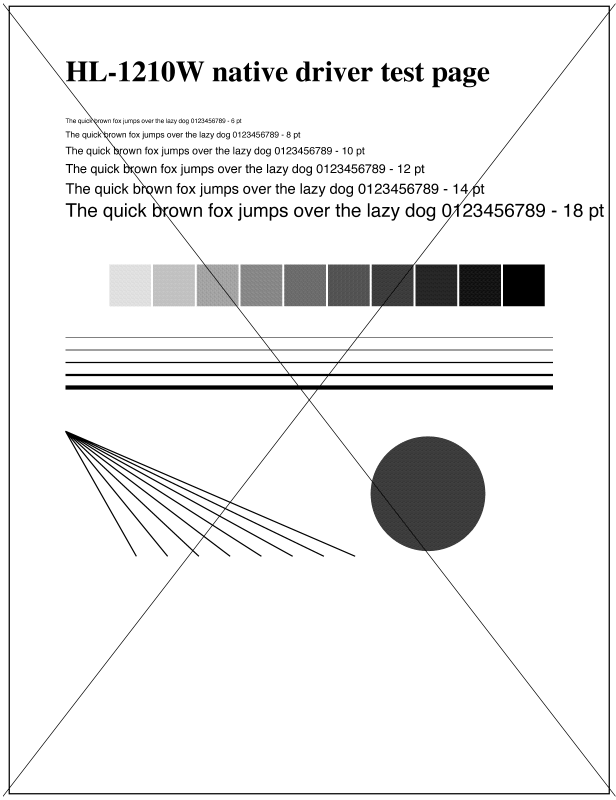

# Brother HL-1210W — native macOS driver

A small, self-contained CUPS driver that lets a Brother HL-1210W (and the
identical HL-1210W "series" variants) print from any Mac app through the normal
print dialog, on Apple silicon, without Rosetta and without iPrint&Scan.

Brother's last macOS driver for this printer is Intel-only, so current Macs can
no longer run it. This is a new driver, written from scratch against the
printer's data format (see [docs/protocol.md](docs/protocol.md)). It is an
independent project and is not produced or endorsed by Brother.

**Status:** printing on a real HL-1210W over Wi-Fi from macOS 27 on Apple
silicon, at the default 600 dpi. The other resolutions and USB produce data
that matches Brother's driver in testing but have not been run on paper yet.

The story of how it was built and checked is in
[docs/writeup.md](docs/writeup.md).



*A test page decoded back from the driver's output with `tests/brdecode.py`.*

## What you get

| Installed file | Purpose |
| --- | --- |
| `/Library/Printers/HL1210W-Native/Filter/rastertohl1210w` | the driver: a universal (arm64 + x86_64), code-signed CUPS raster filter |
| `/Library/Printers/PPDs/Contents/Resources/Brother HL-1210W series native.gz` | printer description: paper sizes and options |
| `/Library/Printers/HL1210W-Native/Icons/HL1210W.icns` | printer icon (only if a Brother driver package was available at build time) |
| `/Library/Printers/HL1210W-Native/uninstall.sh` | removes all of the above |

Nothing runs in the background and nothing is added to the print dialog except
the printer's own options.

## Build and install

Requires macOS 11 or later and the Xcode command line tools.

```bash
make            # build
make check      # run the self-tests
make pkg        # dist/HL1210W-Native-Driver-1.0.pkg
```

Install either by opening the package, or from the terminal:

```bash
sudo installer -pkg dist/HL1210W-Native-Driver-1.0.pkg -target /
```

Then add the printer. Either run

```bash
sh packaging/add-printer.sh
```

or use **System Settings → Printers & Scanners → Add Printer…**, select the
HL-1210W, and under **Use** choose **Select Software…** →
**Brother HL-1210W series - native open driver**.

To remove the driver: `sudo sh /Library/Printers/HL1210W-Native/uninstall.sh`.

The build signs the filter ad hoc with the hardened runtime, which is all a Mac
needs to run something built on it. To hand the package to other people, sign
with your Developer ID and notarize it:

```bash
make pkg CODESIGN_IDENTITY="Developer ID Application: …" INSTALLER_IDENTITY="Developer ID Installer: …"
```

### Halftone screens

The printer's tone reproduction depends on the halftone screens it was tuned
with. If Brother's driver package (`Brother_PrinterDrivers_MonochromeLaser`) is
installed or sits next to this folder, the build reads its screen files and
compiles them in; they are not part of this source tree. Without the package the
build falls back to generic clustered-dot screens, which print fine but render
greys a little differently. `make BROTHER_LUT_DIR=…` or `make BROTHER_PKG=…`
point the build somewhere else.

A filter or package built with Brother's screens (or icon) contains Brother's
data, so keep those builds for your own machines. To build something you can
pass on, use the generic screens:

```bash
make pkg BROTHER_LUT_DIR= BROTHER_ICON= BROTHER_PKG=
```

## Print options

All options appear under **Printer Options** in the print dialog.

| Option | Choices |
| --- | --- |
| Resolution | **600 dpi** (default) · 600 dpi (Fast, smoothed from 300 dpi — the method Brother's driver used) · 300 dpi (Draft) · HQ 1200 |
| Media Type | Plain Paper · Recycled Paper |
| Graphics Quality | Graphics · Text (halftone screen) |
| Toner Save Mode | Off · On |
| Improve Print Output | Off · Reduce Paper Curl · Improve Toner Fixing |
| Skip Blank Pages | Off · On |
| Density Adjustment | Printer Default · −6 … +6 |

Paper sizes: A4, Letter, Legal, Folio, Executive, A5, A5 long edge, B5, JIS B5,
the three 16K sizes, 210 × 270 mm, and custom sizes from 420 × 420 to
612 × 1008 points.

## How it is checked

* **Against Brother's code.** The original filter's compression, smoothing and
  margin routines are executed in an emulator on a set of synthetic pages, and
  this driver must produce the same bytes. The reference outputs are stored in
  `tests/golden`; `tests/compare_original.py` regenerates them from the original
  binary with Ghidra.
* **Against the format.** An independent decoder (`tests/brdecode.py`) turns the
  driver's output back into bitmaps, which must match the halftoned input.
* **End to end.** The built filter is run on CUPS raster files and its complete
  output (PJL header, pages, trailer) is parsed and checked.
* **Fuzzing.** `make fuzz` pushes random pages of awkward sizes through the
  encoder and back through the decoder.

`python3 tests/brdecode.py job.prn --png page` decodes any captured print job
into PNG files, which is handy for looking at what would be printed without
using paper.

## Differences from Brother's driver

* No status-monitor app. Toner level and errors such as "out of paper" come
  from CUPS's standard network queries, where the printer provides them.
* The default resolution is a true 600 dpi rendering rather than a 300 dpi
  rendering enlarged in the driver; the original method is still available.
* No custom print-dialog panel: density is an ordinary option.

## Layout

```
src/        the filter (job framing, smoothing, halftoning, compression)
ppd/        PPD template
packaging/  installer metadata, add-printer and uninstall scripts
tools/      build-time halftone table generator
tests/      self-tests, decoder, emulator harness, reference outputs
docs/       the printer's data format
```
