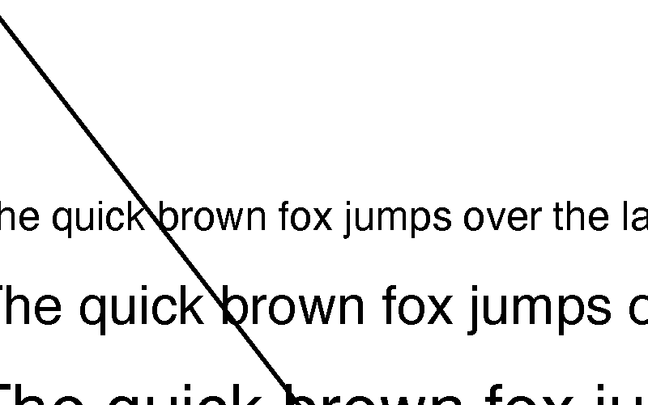
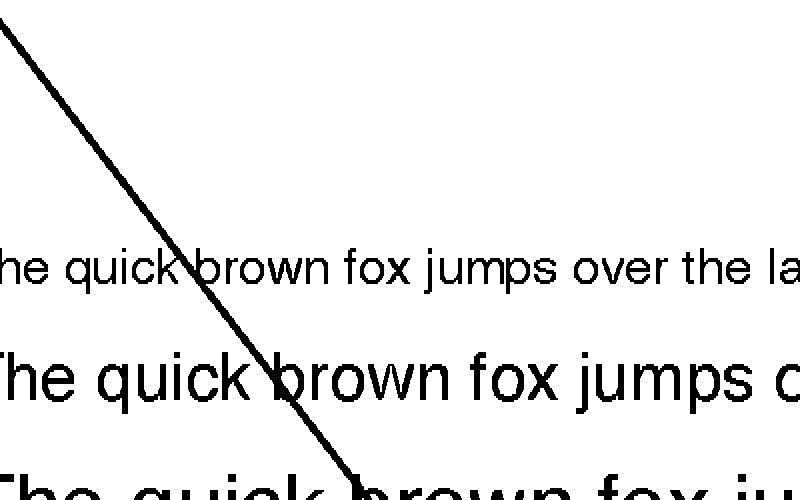
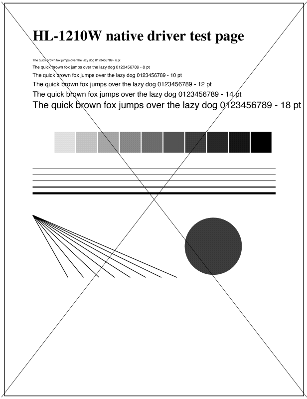

# Reverse engineering a dead printer driver: the Brother HL-1210W on macOS 27

My Brother HL-1210W is a small black-and-white laser printer, and there is nothing wrong with it. What stopped working was the Mac side.

Brother's last macOS driver for it is package version 1.5.0, signed in May 2019. The part that does the actual work, a small program called `rastertobrother1210`, is older than that: version 4.0.0, built with Xcode 5 against the OS X 10.8 SDK, with a code signature timestamped January 2015. It is compiled for Intel processors only. My Mac is Apple silicon running macOS 27, with no Rosetta on it, so trying to launch that program gets "Bad CPU type in executable" and the print job goes nowhere.

I had assumed this was the old 32-bit problem. It isn't. The program is 64-bit, just 64-bit for the wrong chip. Same outcome.

The usual way out for an old printer is AirPrint, and the HL-1210W doesn't have it. The alternative is Brother's iPrint&Scan app. I wanted File > Print to work from any app, the way a printer should.

So this repository is a new driver for that printer. It is about 1,400 lines of C, it installs four files, and the first page I sent through it came out right.

## How it got built

I want to be clear about this early, because it shapes the rest of the story. I did not spend weeks in a disassembler. I gave Claude Code, Anthropic's coding agent, the Brother driver package and a reverse-engineering toolkit called REA that lets it drive Ghidra. I asked for a native driver that follows Apple's guidelines and doesn't need iPrint&Scan. The agent did the decompiling, read the vendor code, worked out the data format and wrote the replacement. I set the goal, installed the result and fed the printer paper. From pointing it at the package to holding a printed page took roughly an hour.

That speed is the reason most of this write-up is about checking. A printer driver that is subtly wrong doesn't raise an error. It prints garbage, or half a page, or nothing, and you find out one sheet at a time. A fast port of somebody else's undocumented format is not something to trust because it looks plausible, whoever or whatever wrote it. The question I cared about was how anyone would know the driver is right.

## Where a driver sits on a Mac

Printing on macOS goes through CUPS. An app hands over a PDF. Apple's rasteriser turns each page into a bitmap, in this case 8-bit greyscale at whatever resolution the driver asks for. A "filter" program supplied by the printer maker then converts that bitmap into the bytes the printer understands, and a backend delivers those bytes over the network or USB.

For a printer like this one, the filter is the driver. Beside it sits a PPD file, a text description of paper sizes and options that tells macOS what to show in the print dialog and which filter to run. Everything else in Brother's package is optional, and there is a lot of it: 2,898 files and 55 MB installed, covering dozens of models, with a status monitor app and print-dialog plug-ins on top.

That made the job small on paper. One filter, one PPD.

## What Brother's filter does

Ghidra found 231 functions in the filter. It is shared across a family of printers, so plenty of it is fax, secure print and duplex code that this model never reaches. The path an ordinary page takes is around three dozen functions, and they have helpful names like `MBeginJob`, `HalftonePixMap` and `MSendBandData`, because the binary shipped with its symbols intact.

A print job has three layers.

The outer layer is PJL, the plain-text job language HP introduced in the early 90s. Nearly thirty lines of it go out before any page data: job name, user, resolution, toner save, paper type, paper size.

```
@PJL SET RESOLUTION = 600
@PJL SET ECONOMODE = OFF
@PJL SET MEDIATYPE=REGULAR
@PJL SET PAPER = A4
@PJL ENTER LANGUAGE = PCL
```

One odd thing in there: every job sets the printer's sleep timer to one minute. That is what Brother's driver does for this model, so the new one does the same.

Inside that is a thin PCL wrapper: reset, paper source, number of copies, and a command that says raster data follows in compression mode 1030.

Inside that is the page itself, one bit per pixel, compressed a line at a time. Each line is stored as a list of edits to the line above it: skip so many bytes, then either replace the next few bytes or repeat a single byte some number of times. A completely white line is one byte, `FF`. A line identical to the one above is one byte, `00`. Lines are packed into blocks of at most 128 lines or 16 KB. It suits printed pages, which are mostly white space and vertical strokes. A full Letter page of text and graphics at 600 dpi comes to well under 200 KB.

The printer's own network announcement agrees with all this. It lists its command languages as `PJL,HBP`. I take HBP to mean host-based printing: the computer does all the rendering and the printer lays down dots.

Two details were more interesting than the format.

The first is halftoning. The printer can only do black or white, so greys become patterns of dots. Each pixel is compared with a 32 by 32 grid of thresholds tiled across the page, and it prints if it is darker than the threshold. Brother ships those grids as small files, tuned per resolution, in "Graphics" and "Text" versions. They decide whether a photo looks right or muddy, and they are Brother's work, so they are not in this repository. The build reads them from the Brother package you already have, and uses a generic dot screen if you don't have one.

The second is that Brother's "600 dpi" was not quite what it said. For this model their driver asks macOS for a 300 dpi page, doubles every pixel itself, and then runs a clean-up pass that looks for the inside corners of diagonal edges and fills in half-pixels so slanted strokes don't turn into staircases. It is about 250 lines of fiddly logic in the decompiler. The new driver keeps that mode as "600 dpi (Fast)" and makes the default a real 600 dpi page from the rasteriser. Brother's filter has a code path for that too. Their PPD for this model simply never selects it.



*True 600 dpi, decoded from the driver's output.*



*The same text rendered at 300 dpi and smoothed up to 600, the way Brother's driver did it.*

Positioning is done in the data as well. The print engine starts a fixed distance in from the paper edge (80 dots at 600 dpi), and the driver places the image by sending a run of white bytes at the start of every line. A custom page size is reported to the printer as the smallest standard paper that contains it, and the image is centred on that.

The original also has a small bug in that area. A left margin of exactly one byte gets encoded as a malformed command. It can't happen with this printer's real paper sizes, and it is the one place the new driver deliberately differs.

## The new driver

The filter reads the bitmap, optionally does the 300-to-600 smoothing, halftones, compresses, and wraps the result in the PJL and PCL framing. It is a universal binary for Apple silicon and Intel, code-signed with the hardened runtime, and it links against nothing except the system's CUPS library.

Some of the choices in it:

Brother's driver used a print-dialog plug-in for a few settings, and that plug-in is Intel-only as well. In the new driver every setting is an ordinary PPD option: resolution, paper type, toner save, density, skip blank pages. They appear under Printer Options in the standard dialog.

The filter never parses the PPD. CUPS lets a PPD stamp settings into the header of each rasterised page, and the filter reads them from there. That avoids the PPD-parsing API that CUPS has deprecated, and it makes the filter easy to test: give it a raster file and it gives back printer bytes.

The installer adds four files under `/Library/Printers` and nothing else. There is no background process, no login item and no app. It leaves the permissions of existing system folders alone.

It is quick, which is no surprise given how little work is involved. Three pages at 600 dpi go through in about 50 milliseconds.

## Proving it

Normally you would check a rewrite by running the original and the new version side by side and comparing what comes out. Here the original can't run. That was the whole problem.

The way around it is to run Brother's code without running Brother's program. Ghidra includes an emulator that can execute individual functions from a binary, one instruction at a time, on any machine. The test harness loads the original Intel filter, sets up memory the way it would be in the middle of a job, calls Brother's own routines on a test page, and captures what they write. Whenever the vendor code calls out to the system, a small hook answers in its place. There are 27 of those, for things like `malloc`, `printf`, `strcmp` and the CUPS option lookups.

The new driver then processes the same page, and the two outputs have to match byte for byte.

There are 110 of these comparisons:

- 15 whole pages through halftoning, smoothing and compression. The pages are synthetic and built to be awkward: lines that need more than 253 edit commands (where the format switches to a fallback), blocks that hit the 16 KB limit, pages that cross the 128-line boundary, margins big enough to overflow the length fields.
- 4 runs of the smoothing pass on its own.
- 12 checks of the margin arithmetic.
- 79 runs of Brother's job-header code, covering every paper size at every resolution plus mixes of the other options. These compare the complete PJL header, down to how the date is formatted.

All 110 match.

Emulation is slow. A test page the real filter handles in a few milliseconds takes up to two and a half minutes, and the full set takes the better part of ten. So the vendor's outputs are stored in the repository, and the normal test run compares against those without needing Ghidra or the original binary.

Two other checks sit beside that. A decoder, written from the format description rather than from the encoder, turns the driver's output back into a bitmap and compares it with the input. It has a useful side effect: any captured print job can be turned into a PNG, so you can look at what would be printed without spending paper. And a fuzz test pushes 250 random pages of odd sizes through the same round trip.



*A test page decoded back from the bytes the driver sends.*

None of that is the same as paper coming out of a printer. That was the last test, and the only one that needed me. I installed the package, added the printer in System Settings with the new driver, and printed. It worked first time, at true 600 dpi.

## What it doesn't do

- There is no status monitor. Brother's driver had its own channel for toner levels and errors. The new one leaves that to the standard queries CUPS makes, and I haven't checked how much this printer reports that way.
- I have printed at the default 600 dpi over Wi-Fi. The other resolutions and USB are checked against Brother's code, not against paper.
- I have one printer. Brother's package has sibling filters for the HL-1110 and HL-1200 families and the format is probably close, but I can't test those.
- Apple has deprecated this kind of printer driver in favour of AirPrint. Drivers still work on macOS 27, and CUPS prints a warning when you add one. For a printer without AirPrint there is no alternative, but it does mean this has a shelf life.
- There is an existing open-source driver, brlaser, for several Brother lasers in this family. This project isn't based on it. The aim here was narrower: reproduce what Brother's own driver sends, byte for byte, and be able to show it.

## What I took from it

The printer was never the problem. As far as my Mac was concerned, a working machine was one 126 KB Intel program away from being e-waste.

The other thing is about doing this kind of work with an AI agent. Getting a driver written was the quick part. What made it something I was willing to install is that the checking doesn't rest on trusting the agent, or me. Brother's own code is the reference, the comparison is a byte-for-byte diff, and anyone with the original package and Ghidra can run it again.

The repository has the driver, the tests, the emulator harness and a description of the data format in [protocol.md](protocol.md). It contains none of Brother's code or data, and it is not affiliated with or endorsed by Brother.
